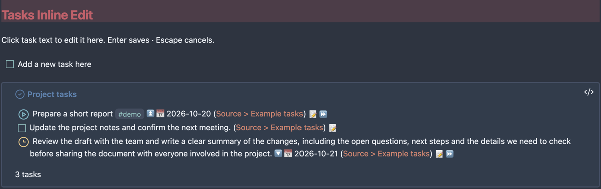

# Tasks Inline Edit

Edit task descriptions directly in rendered [Tasks](https://github.com/obsidian-tasks-group/obsidian-tasks) queries, while continuing to write ordinary Markdown around them.

Click the description to place a caret, change the text, then press **Enter** to save or **Escape** to cancel. Clicking outside saves changed text. Blank query and callout space stays rendered in Live Preview instead of exposing the query code. Long descriptions keep their normal wrapping when editing begins.



## What it does

- Borderless editing in Live Preview and Reading view.
- Writes the description back to its original task note.
- Preserves recognized status, priority, dates, recurrence, IDs and other suffix metadata.
- Leaves checkboxes, status menus, links, dates, the Tasks pencil and callout folding available.
- Checks the source line before writing and refuses ambiguous or conflicting edits.

The colored task blocks and custom status icons in the screenshot come from a separate CSS snippet, not this plugin.

## Parent context in task lists

In **Settings → Tasks Inline Edit**, use **Показывать контекст родительских задач** to show or hide ancestor labels. It is enabled by default, applies immediately, and is remembered after restart. Disabling it also stops context observers; inline editing remains available.

Flat query results show a muted, clickable ancestor chain below each unambiguously identified subtask. Tasks keep their own statuses and query membership. Labels follow the source nesting, including ordinary list items, and refresh when the source changes. Clicking an ancestor opens its exact source line in the editor (also from Reading view), after checking that the cached line is still current. The feature does not rewrite task descriptions or add IDs.

Rows that cannot be mapped uniquely (for example identical descriptions and statuses with the same backlink) receive no context, rather than a guessed parent. Nested rows already displayed by `show tree` are not decorated. Context is supported in the main desktop window in Live Preview and Reading view.

## Compatibility

Desktop Obsidian **1.13.7 or newer**, with Tasks **8.4.0 or 8.5.0**. The current release was tested in Obsidian 1.13.7 on macOS with Tasks 8.5.0. Windows, Linux and other themes have not received manual acceptance testing. Mobile is not enabled.

Task mapping depends on internal Tasks APIs and DOM classes. Inline writes are enabled only for the two supported Tasks versions. Other versions show a notice; use the native pencil while an updated adapter is being verified. Recognized query backgrounds remain protected against accidental source activation.

## Install

Available in the [Obsidian Community directory](https://community.obsidian.md/plugins/tasks-inline-edit). Open **Settings → Community plugins → Browse**, find **Tasks Inline Edit**, then install and enable it. Install and enable Tasks separately.

For manual installation, download `main.js`, `manifest.json` and `styles.css` from the [latest release](https://github.com/GeoKhv/obsidian-tasks-inline-edit/releases/latest). Put them in `<vault>/.obsidian/plugins/tasks-inline-edit/`, reload Obsidian, and enable **Tasks Inline Edit** in Community plugins. Install and enable Tasks separately.

For [BRAT](https://github.com/TfTHacker/obsidian42-brat), add `GeoKhv/obsidian-tasks-inline-edit`.

## Limits and safe fallbacks

- Exact duplicate descriptions/statuses can be ambiguous, especially with hidden backlinks. The plugin refuses these edits.
- Editing displays raw Markdown for links and formatting. Raw syntax can take more space than its rendered form; this is normal. Clicking existing links follows their normal action.
- Some unusual formatting or metadata placement is refused by the conservative parser.
- Changes in an open source editor must be saved before inline writing can proceed.
- Native Tasks actions can reorder metadata while its cache retains an older source line. If a notice says the cache no longer matches, use the pencil. The exact-source guard is deliberately retained.
- A save conflict keeps your entered text in place and leaves the file unchanged. Resolve the source conflict before retrying.
- Descriptions must be nonempty single lines. Enter saves rather than inserting a newline.

## Privacy and license

The plugin runs locally. It makes no network requests, collects no telemetry, needs no account, and accesses no files outside the vault. It reads Tasks' in-memory cache and checks Markdown filenames in the vault to disambiguate source backlinks. It writes only the selected task's source note through `Vault.process()`. Obsidian or other installed plugins may sync or process that note independently.

MIT © 2026 Geo. This is an independent companion, not an official Obsidian or Tasks product.

## Development

```sh
npm ci
npm run check
npm test
```

`npm test` builds the plugin and runs the source-edit and event-routing tests. Run `npm run build` to rebuild without tests. See [manual acceptance](docs/acceptance.md) for real-app checks. Release artifacts are built in GitHub Actions, include SHA-256 checksums, and have GitHub artifact attestations.
